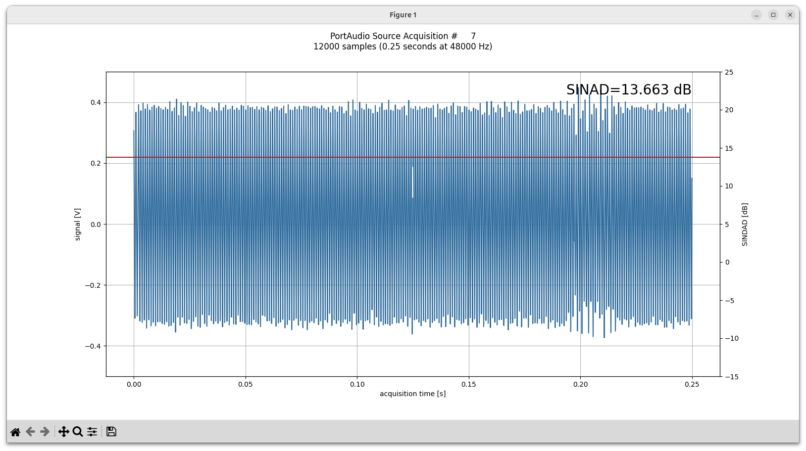
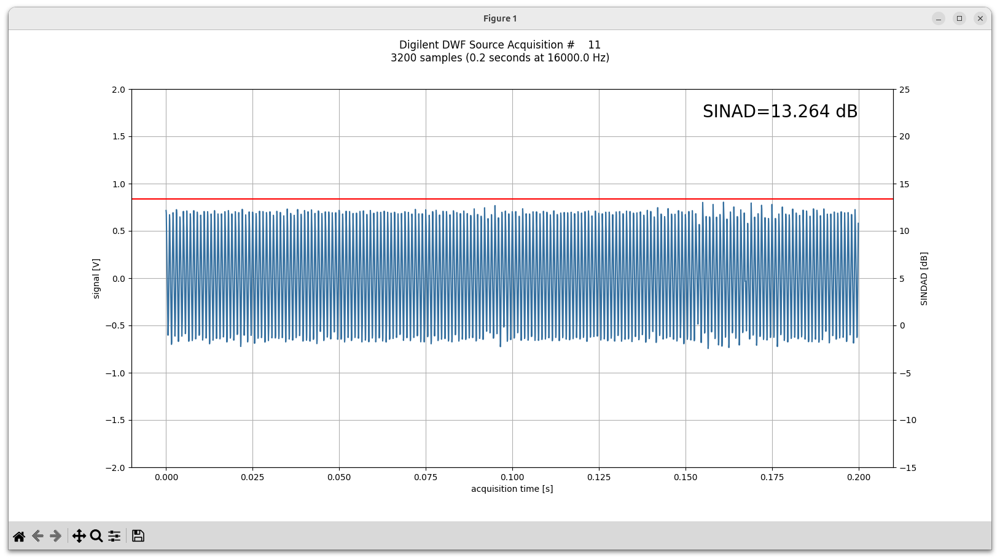
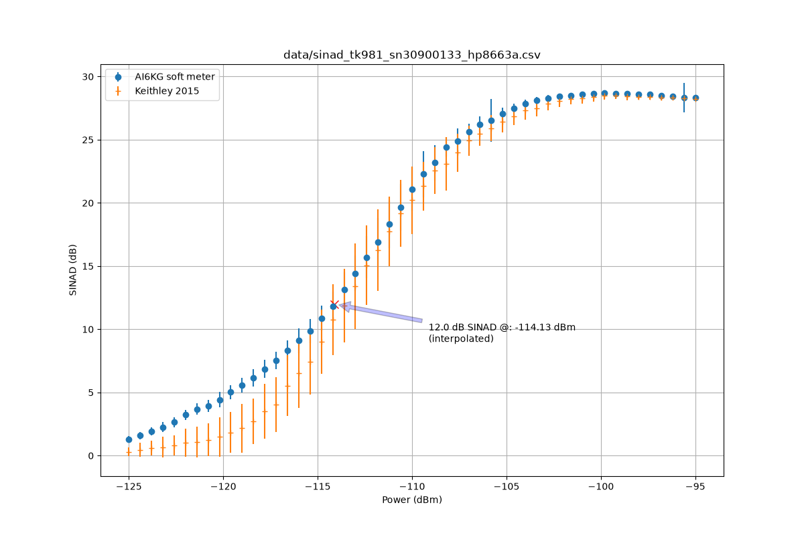
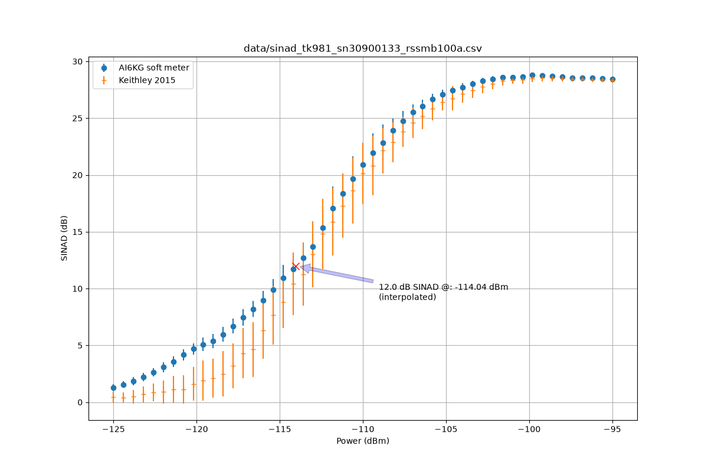

# Software SINAD meter

This is a software SINAD meter.  It display both the audio waveform
and the SINAD for the current acquisition window and a filtered SINAD
value as text.




In this video, the synthesizer ramps up power into the receiver and
the SINAD subsequently increases:

[](https://youtu.be/gy6IAjbTO2o)

## Performance

The results match reasonably to a Keithley 2015 THD Multimeter.




Note that the plotting script annotates the graph with the standard
12 dB SINAD point.

## Synthesizer Control

If you have an HP8663A (or probably HP866[23][AB]) or an R&S SMB100A,
the program can automatically do a SINAD sweep.  This is how the
graphs above were created.

The sweep sets the carrier (`--frequency`, required) and, where the
generator supports it, the TIA-603 test modulation: 1 kHz FM at 3 kHz
deviation by default (`--mod-rate`, `--deviation`; use 1500 Hz for
12.5 kHz channels).  The SMB100A does this; the HP adapter does not yet,
so pass `--modulation-from-front-panel` and set FM by hand.  The CSV
records which was used.

## Receiver Audio Acquisition

For acquisition the code supports:
- bog-standard audio capture devices that PortAudio can talk to
- Digilent devices supported by pydwf (but only AD3 is known to work)


## Running

Dependencies are managed with [uv](https://docs.astral.sh/uv/).  The
instrument drivers come from a submodule, so clone recursively:

```
git clone --recurse-submodules https://github.com/charlieh0tel/sinad_meter.git
```

(For an existing clone, `git submodule update --init`.)

The environment is created on demand, so there is nothing to install
first:

```
uv run ./sinad_meter.py
```

`uv run` works for the other scripts here too, e.g. `uv run ./auto_sinad.py`.

## Contributing

Lint and formatting are checked on commit by a git hook run with
[prek](https://github.com/j178/prek), which is pinned in `uv.lock` like
everything else.  Install the hook once per clone:

```
uv run --frozen prek install
```

The hook, the tests, and any other tool run through uv, as
`uv run --frozen …`.  Don't install anything into `.venv` by hand: uv
rebuilds it from the lockfile and will drop it.  To try another Python
version, use `uv run --isolated --python 3.X pytest`, which leaves
`.venv` alone.

It mainly has been tested on Linux.  It appears to run on Windoze fine.

73 DE AI6KG<br />
Christopher Hoover<br />
Mountain View, California

